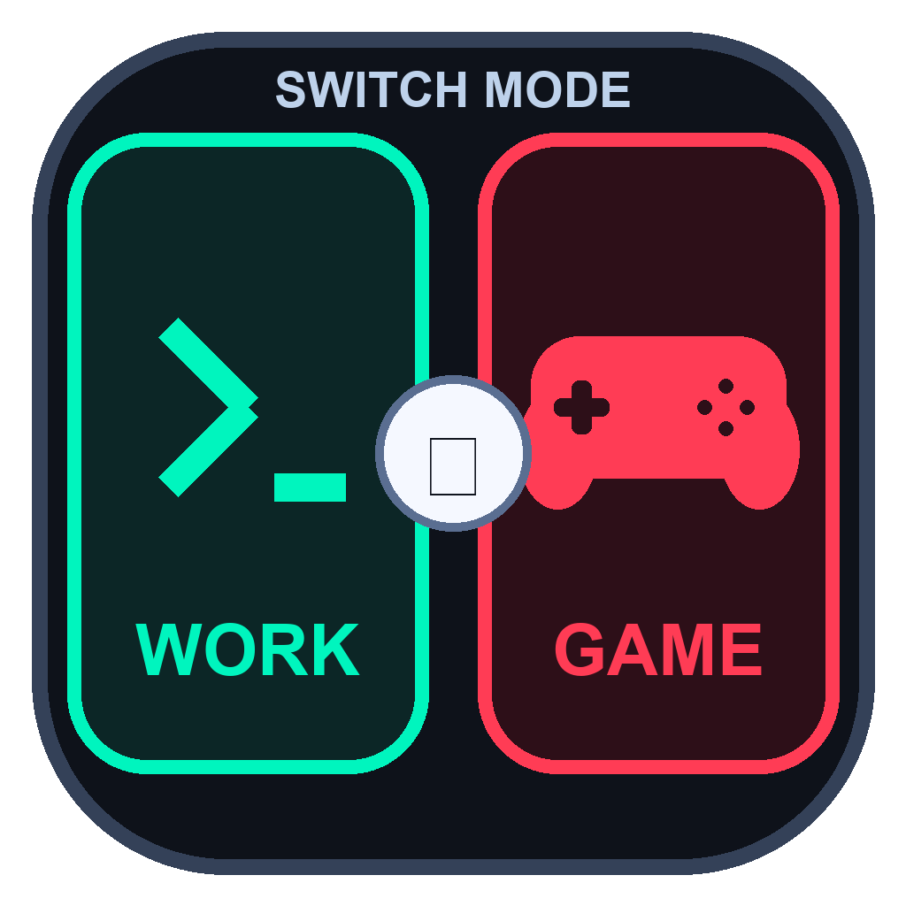

# ⚡ Win Mode Switch (`win-mode-switch`)

> **Instant 1-Click Toggle between Work Mode (Docker, WSL2, Ollama) and Gamer Mode (100% GPU/VRAM focus) with ultra-minimalist visuals and custom audio cues.**

<p align="center">
  
</p>

<p align="center">
  
  
  
  
</p>

---

## 🎯 The Problem

Developers who love PC gaming know the struggle:
* You have **Docker Desktop**, **WSL2**, and local LLMs (**Ollama / llama-server**) running in the background.
* WSL2 and Ollama alone frequently hog **8 GB to 10+ GB of VRAM** and substantial system RAM/CPU cycles.
* When you launch a modern game (e.g., Cyberpunk 2077, eFootball/PES, Flight Simulator, Helldivers 2), you experience micro-stutters, texture pop-in, or out-of-VRAM crashes.
* Manually opening Task Manager, stopping Docker, shutting down WSL2, killing Ollama, and switching Windows Power Plans every time is tedious — and restarting them all later is just as annoying.

## 🚀 The Solution: `win-mode-switch`

A lightweight, zero-latency toggle that seamlessly flips your Windows environment between two states:

| Feature | 🎮 **GAMER MODE** | ☕ **WORK MODE** |
| :--- | :--- | :--- |
| **GPU / VRAM** | **100% Freed** for the game | AI models & containers active |
| **Ollama / Local LLMs** | Terminated immediately | Automatically launched |
| **Docker Desktop & Services** | Stopped & background services halted | Services started & Desktop opened |
| **WSL2 Hypervisor** | Completely shut down (`wsl --shutdown`) | Initialized (`Ubuntu`) |
| **Windows Power Plan** | **Ultimate Performance** | Balanced |
| **Audio Feedback** | 🥊 **Hadouken!** (Street Fighter, 1.1s) | 🎹 **The Office Theme** (Iconic intro, 2.6s) |
| **Taskbar Tray Indicator** | 🔴 Neon Coral **`G`** (Ultra-legible badge) | 🟢 Neon Cyan **`W`** (Ultra-legible badge) |

---

## ✨ Features

* **⚡ Blazing Fast**: Native Win32 Rust tray app (`modeswitch.exe`) using less than **2 MB of RAM**.
* **👀 Highly Readable from a Distance**: Custom minimalist high-contrast icons for desktop, notification tray, and widgets designed specifically to be easily recognized from across the room.
* **🔊 Instant Audio Cues**:
  * Switching to Game Mode: Plays a punchy 1.1s **Hadouken!** sound.
  * Switching to Work Mode: Plays a crisp 2.6s **The Office Theme** piano riff.
* **🖱️ Multiple Ways to Toggle**:
  1. **System Tray Icon**: Left-click for instant toggle; right-click for full menu.
  2. **Desktop Shortcut**: Double-click the high-res desktop shortcut.
  3. **Rainmeter HUD Widget**: Clean desktop widget showing live status.
* **⚽ In-Game Instant Replay & WhatsApp Auto-Delivery**:
  * Triggered instantly from your gamepad (**L3 + R3** or **Back + Start**) across XInput slots 0..3.
  * **Zero-drift parallel capture**: Decoupled video (DirectX DDA / NVENC 60 FPS) and audio (loopback) recording pipelines eliminate DirectShow frame drops.
  * **Transparent Floating HUD**: Minimalist colorkey overlay with pulsating record dot, live 30s countdown, and WhatsApp delivery indicators.
  * **Automatic WhatsApp Upload**: Directly sends the 30-second replay clip to your WhatsApp number via API in seconds.
* **🛡️ Zero Overhead**: Uses native Windows APIs (`windows-sys`), no heavy frameworks, no electron, zero telemetry.

---

## 📂 Repository Structure

```
win-mode-switch/
├── assets/
│   ├── icons/
│   │   ├── mode_switch.ico    # High-resolution multi-size desktop icon
│   │   ├── mode_switch.png    # High-resolution banner / widget preview
│   │   ├── coffee.ico         # Work Mode tray icon (Neon Cyan 'W')
│   │   └── gamer.ico          # Gamer Mode tray icon (Neon Coral 'G')
│   └── sounds/
│       ├── hadouken.wav       # Gamer mode sound effect (1.1s)
│       └── theoffice.wav      # Work mode sound effect (2.6s)
├── rainmeter/
│   └── ModeSwitch/
│       ├── ModeSwitch.ini     # Minimalist Rainmeter desktop HUD
│       └── icon.png
├── scripts/
│   └── toggle_mode.ps1        # Core PowerShell automation engine
├── src/
│   └── main.rs                # Native Win32 Rust tray application
├── Cargo.toml
├── install.ps1                # 1-Click Windows installer
├── LICENSE
└── README.md
```

---

## 🛠️ Quick Installation

### Option 1: One-Click PowerShell Installer

Clone or download this repository, open PowerShell as Administrator or regular user, and run:

```powershell
git clone https://github.com/daraujo85/win-mode-switch.git
cd win-mode-switch
.\install.ps1
```

The installer will:
1. Copy the scripts, icons, and sounds to `%USERPROFILE%\scripts\`.
2. Compile or place `modeswitch.exe`.
3. Create the desktop shortcut `Alternar Modo Gamer e Work.lnk`.
4. Configure automatic startup with Windows (`Startup\modeswitch.lnk`).
5. (Optional) Install the Rainmeter skin if Rainmeter is detected.

### Option 2: Building from Source (Rust)

Ensure you have Rust installed (`cargo`):

```bash
cargo build --release
```

The optimized binary will be created at `target/release/modeswitch.exe`.

---

## ⚙️ Customization

### Changing the Sounds
Replace `assets/sounds/hadouken.wav` or `assets/sounds/theoffice.wav` with your own `.wav` files and copy them to `%USERPROFILE%\scripts\`.

### Adjusting Applications to Close/Open
Edit `scripts/toggle_mode.ps1`:
* To add more dev apps to close (e.g. IntelliJ, VSCode, Android Studio), add them to the `Get-Process ... | Stop-Process` block.
* To launch additional apps upon returning to Work mode, add `Start-Process` calls.

---

## 📄 License

This project is open-source and released under the [MIT License](LICENSE).
Feel free to fork, customize, and submit pull requests!
